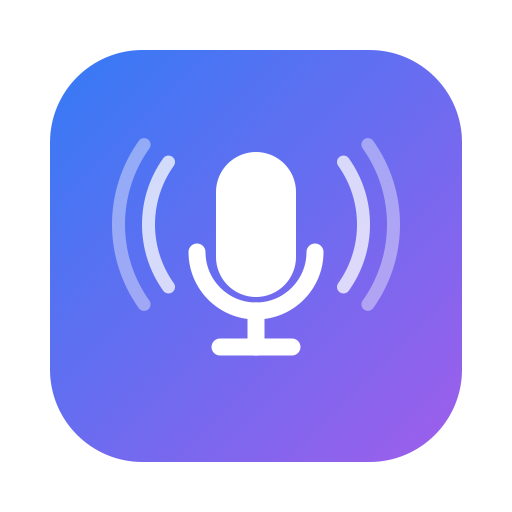

<p align="center"></p>

<h1 align="center">Talk2Mac</h1>

Dictée vocale pour macOS, pensée pour fonctionner **dans une VDI** (Windows App / RDP) :
le texte est tapé via de vrais événements clavier, sans dépendre du presse-papiers partagé.

Maintiens la touche push-to-talk (⌘ droite par défaut), parle, relâche : l'audio est
transcrit en local avec [whisper.cpp](https://github.com/ggml-org/whisper.cpp), nettoyé
(« euh » retirés, dictionnaire perso), puis tapé dans l'application active.

## Prérequis
- macOS 13+, Command Line Tools (`xcode-select --install`), `cmake`
- Un modèle Whisper, par ex. `ggml-small-q5_1.bin`

## Installation

### Option 1 : DMG (le plus simple)
Ouvre `Talk2Mac.dmg`, glisse **Talk2Mac** dans **Applications**, lance-le. `whisper-cli` et le
modèle sont embarqués dans l'app : rien d'autre à installer. Comme l'app n'est pas notarisée,
au premier lancement : clic droit > **Ouvrir**.

Pour générer le DMG (après avoir compilé whisper-cli et récupéré le modèle, voir ci-dessous) :
```sh
./package.sh   # -> build/Talk2Mac.dmg
```

### Option 2 : script d'installation depuis les sources
```sh
./install.sh   # compile whisper.cpp, télécharge le modèle, installe dans /Applications
```

### Option 3 : manuelle
```sh
git clone --depth 1 https://github.com/ggml-org/whisper.cpp vendor/whisper.cpp
cmake -S vendor/whisper.cpp -B vendor/whisper.cpp/build -DBUILD_SHARED_LIBS=OFF -DGGML_METAL=OFF  # sur Mac Apple Silicon, retire GGML_METAL=OFF
cmake --build vendor/whisper.cpp/build -j4 --target whisper-cli

mkdir -p "$HOME/Library/Application Support/Talk2Mac"
curl -L -o "$HOME/Library/Application Support/Talk2Mac/ggml-small-q5_1.bin" \
  https://huggingface.co/ggerganov/whisper.cpp/resolve/main/ggml-small-q5_1.bin

./build.sh && open build/Talk2Mac.app
```
Au premier lancement, accorde **Micro**, **Accessibilité** et **Surveillance de l'entrée**
(Réglages Système > Confidentialité et sécurité), puis relance l'app.

## Configuration
`~/Library/Application Support/Talk2Mac/config.json` :

| Clé | Rôle |
|---|---|
| `hotkey` | `rightCommand`, `leftOption`, `fn`… ou `key:105` (F13). Plus simple : menu > **Définir le raccourci…** |
| `touchBar` | indicateur sur la Touch Bar (rouge = enregistrement, orange = transcription, vert = envoyé) |
| `sounds` | retours sonores on/off (aussi dans le menu) |
| `startSound` / `stopSound` / `doneSound` / `errorSound` | sons système : début, fin d'enregistrement, texte tapé, erreur/rien compris |
| `language` | `auto`, `fr`, `en` |
| `whisperPath` / `modelPath` | chemins du binaire et du modèle |
| `keyDelayMs` / `chunkSize` | cadence de frappe (à augmenter si la VDI perd des caractères) |
| `fillers` | mots parasites à retirer |
| `dictionary` | remplacements `{"entendu": "voulu"}` |

Journal de debug : `~/Library/Application Support/Talk2Mac/log.txt`.
